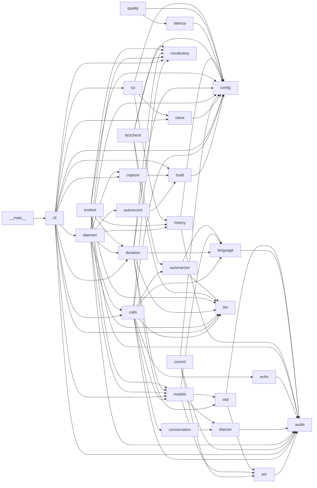

# Архитектура

Карта Python-кода. Её обновляет агент: в PR, который меняет модули, публичные функции или типы, и на структурном ревью. Строится по коду (команда Graph в CLAUDE.md), а не по плану. Swift-часть (`wav2sum/native/`) и протокол сокета описаны в SPEC.md.

Последнее структурное ревью: CHU-153, 28.10.2026. Циклов зависимостей нет.

Запись звонка сохраняется автоматически; остановка и запуск демона не ставят её в очередь. Пользователь выбирает запись в TUI для явного `process`: запрос с путём возвращает задание, а `record_stop` — только путь. Демон отклоняет активную или завершающуюся запись, повторное задание queued/running, неоднозначные записи с одинаковым stem и существующий результат, включая частичный. Прямой запуск CLI вне демона этими гарантиями не охвачен.

## Модули

| Модуль | Отвечает за | Зависит от |
|---|---|---|
| `cli` | команды `wav2sum`: `transcribe` (по умолчанию), `record`, `mics`, `tui`, `app`, `serve`, `status`, `stop`, `dictate` | audio, build, calls, capture, client, config, daemon, dictation, llm, models, tui, vocabulary |
| `daemon` | демон на Unix-сокете: очередь звонков, диктовка, автозапись | audio, autorecord, calls, capture, config, dictation, history, llm, models, vocabulary |
| `client` | клиент сокета демона для CLI и TUI | config |
| `tui` | Textual-интерфейс: звонки, диктовки, поиск, удаление | client, config, history |
| `calls` | конвейер звонка: эхо → VAD → диаризация → язык → ASR → реплики → summary | audio, config, conversation, echo, language, llm, models, summarizer, vocabulary |
| `capture` | запись звонка Swift-хелпером в WAV | build |
| `autorecord` | какое приложение держит микрофон, когда начать и остановить запись | build |
| `build` | сборка и подпись Swift-хелпера и `.app` | config |
| `echo` | вычитание эха системного канала из микрофона | audio |
| `conversation` | нарезка по репликам, склейка, формат транскрипта | diarizer |
| `summarizer` | summary и главы через LLM, нарезка по токенам | language, llm |
| `dictation` | диктовка: распознавание, чистка, перевод, сниппеты, потоковый ASR | config, language, llm, models, vad, vocabulary |
| `models` | ленивые модели в памяти с lock на каждую | asr, diarizer, language, vad |
| `asr` | GigaAM (русский) и Parakeet (английский) | audio |
| `vad` | Silero VAD, склейка спанов | asr, audio |
| `diarizer` | pyannote | audio |
| `language` | определение языка по звуку и по тексту | audio |
| `llm` | mlx-lm в одном потоке, выгрузка, кэш префикса, prompt lookup | — |
| `vocabulary` | словарь замен, который учится на правках | — |
| `history` | история диктовок, удаление звонков и диктовок | audio, config |
| `config` | `config.toml`, пути, файловый lock | — |
| `audio` | загрузка звука, PCM, хеш файла | — |
| `coreml` | конвертация GigaAM в Core ML (CHU-98), только macOS | asr, audio, config |
| `evalset` | WER диктовки на наборе фраз | audio, config, dictation, history, llm, models, vocabulary |
| `factcheck` | числа и имена в summary, которых нет в транскрипте | config, llm, summarizer, vocabulary |
| `latency` | задержки диктовки по истории | config |
| `quality` | качество диктовки по истории | config, latency |

## Публичные функции

Только те, что зовут из других модулей.

| Функция | Вход | Выход | Побочные эффекты | Кто вызывает |
|---|---|---|---|---|
| `cli.main` | argv | — | всё, что делает команда | `__main__` |
| `daemon.serve` | `Config`, `verbose` | — | пишет конфиг по умолчанию, лог, слушает сокет | cli |
| `client.DaemonClient` | запросы демону | ответы, события | сокет | cli, tui |
| `calls.process` | путь к звуку, `Models`, папка, `LLM`, раскладка, `Speakers`, `Names`, язык, `Vocabulary` | `Result` | пишет `transcript.txt`, `summary.md`, `meta.json` и кэш в `.cache/` | cli, daemon |
| `capture.CallRecorder` | путь WAV, микрофон, приложение звонка | `start`/`wait`/`stop` | процесс хелпера, WAV и сайдкар `.json` | cli, daemon |
| `capture.list_mics` | — | `str` | собирает и запускает хелпер | cli |
| `capture.new_recording_path` | папка записей | `Path` | нет | cli, daemon |
| `autorecord.CallDetector` | события микрофона | решение start/stop | нет | daemon |
| `build.capture_helper` | — | `Path` | собирает и подписывает хелпер в `BUILD_DIR` | autorecord, capture |
| `build.install_app` | — | `Path` | собирает, подписывает и ставит `.app` | cli |
| `dictation.Dictator` | звук, приложение, режим, текст у курсора | `Dictation` | грузит модели, вызывает LLM | cli, daemon, evalset |
| `dictation.DictationStream` | куски звука | спаны текста | нет | daemon |
| `dictation.user_examples` | правки из `edits.jsonl` | примеры на стиль и язык | нет | daemon, evalset |
| `summarizer.summarize` | транскрипт, `LLM`, термины, язык | `str` | вызывает LLM | calls, factcheck |
| `summarizer.chapters` | транскрипт с таймкодами, `LLM`, язык | `str` | вызывает LLM | calls |
| `llm.LLM` | модель, `num_ctx`, `keep_alive`, `timeout` | `chat`, `count_tokens`, `unload` | глобальные `_loaded`, `_timers`, `_prefixes`, поток `llm` | calls, cli, daemon, dictation, factcheck, summarizer |
| `llm.memory_mb` | — | `int` | нет | daemon |
| `models.Models` | устройство, конфиг | модели по запросу | грузит и выгружает модели | calls, cli, daemon, dictation, evalset |
| `vocabulary.Vocabulary` | путь к `vocabulary.json` | `words`, `apply`, `learn` | `learn` пишет `vocabulary.json` | calls, cli, daemon, dictation, evalset, factcheck |
| `history.load_dictations` | путь, лимит | `list[dict]` | нет | daemon, evalset, tui |
| `history.append_dictation` | запись | — | дописывает `dictations.jsonl` под lock | daemon |
| `history.delete_dictation` | запись | `bool` | переписывает `dictations.jsonl` под lock | tui |
| `history.delete_call` | папка звонка, папка записей | — | в Корзину папку, кэш и свою запись | tui |
| `config.load_config` | путь | `Config` | нет | cli, coreml, evalset, factcheck |
| `config.exclusive` | путь, `wait` | `bool` | `flock` на файл | build, cli, history |
| `audio.load_audio` | путь, каналы | `np.ndarray` | ffmpeg | calls, cli, coreml, evalset |
| `audio.file_hash` | путь | `str` | читает файл | calls, history |
| `audio.pcm16_to_float` | `bytes` | `np.ndarray` | нет | daemon |
| `echo.suppress_echo` | микрофон, системный канал | `np.ndarray` | нет | calls |
| `conversation.*` | спаны, реплики, `Turn` | реплики, текст | нет | calls |
| `language.text_language` | текст | язык | нет | dictation |

## Типы и модели данных

| Тип | Где определён | Поля | Наследует / содержит |
|---|---|---|---|
| `Config` | `config.py` | `me`, `them`, `language`, `model`, `num_ctx`, `mic`, `recordings_dir`, `output_dir`, `auto_record`, `call_apps`, `dictation` | содержит `DictationConfig` |
| `DictationConfig` | `config.py` | `hotkey`, `model`, `cleanup`, `learn`, `dictionary`, `snippets`, `apps` | — |
| `Speakers` | `calls.py` | `count`, `min`, `max` | — |
| `Names` | `calls.py` | `me`, `them`, `diarized` | — |
| `Result` | `calls.py` | `out_dir`, `layout`, `language`, `duration_sec`, `utterances`, `summary`, `timings` | содержит `Utterance` |
| `Utterance` | `conversation.py` | `start`, `end`, `text`, `speaker` | — |
| `Piece` | `conversation.py` | `start`, `end`, `speaker` | — |
| `Turn` | `diarizer.py` | `speaker`, `start`, `end` | — |
| `Level` | `capture.py` | `seconds`, `mic_db`, `sys_db` | — |
| `Job` | `daemon.py` | `id`, `audio`, `state`, `stage`, `out_dir`, `error` | — |
| `Dictation` | `dictation.py` | `raw`, `text`, `style`, `language`, `command`, `timings`, `translate` | — |
| `LLM` | `llm.py` | `model`, `num_ctx`, `temperature`, `think`, `keep_alive`, `timeout`, `cache_prefix` | — |
| `Prompts` | `dictation.py`, `summarizer.py` | тексты промптов на язык | — |

## Известные проблемы

- `daemon.py`: `json.loads` строки запроса стоит вне `try`, битая строка молча закрывает соединение без лога (CHU-153, не исправлено).
- `capture` и `autorecord` импортируют сборочный `build.capture_helper`, так что сборка хелпера идёт из рантайма записи (CHU-153, так задумано).
