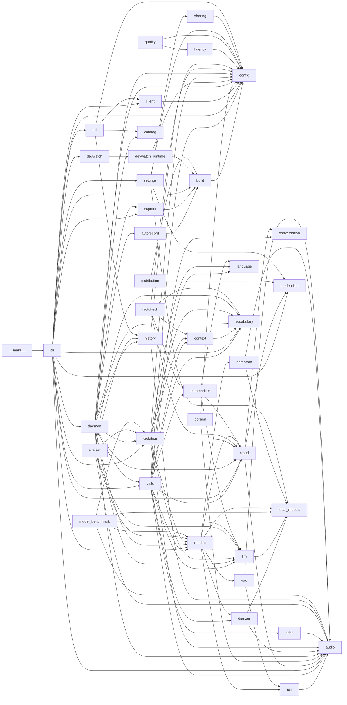

# Архитектура

Карта реализации Python и Swift: зависимости, API и runtime-контракты. Обновляется при изменении модулей, публичных функций/типов и на структурном ревью; граф строится по коду командой Graph из AGENTS.md, не по плану. Продуктовые критерии и ограничения — в [SPEC](SPEC.md), команды и developer flow — в [README](README.md).

Последняя проверка структуры: общий read-only catalog для TUI и native history RPC. Фактический `uv run --offline --no-sync pydeps wav2sum --show-deps --no-output --only wav2sum`: 40 модулей без корневого пакета, 112 внутренних связей; граф ацикличен. Хранение app preferences находится в config, JSON setup bridge — в settings; обратной зависимости config→settings нет.

## Модули

| Модуль | Отвечает за | Зависит от |
|---|---|---|
| `cli` | явный CLI cloud, команды app/daemon/TUI/process/dictate, opt-in dev-watch и JSON setup bridge | audio, build, calls, capture, client, cloud, config, credentials, daemon, devwatch, dictation, models, settings, tui, vocabulary |
| `devwatch` | debounce, immutable snapshot handoff, повторы/восстановление и безопасное завершение dev-сессии | devwatch_runtime |
| `devwatch_runtime` | lock, verified exact-child pipes, перепроверка bundle/путей и lifetime только собственного scratch; использует общий builder | build, config |
| `daemon` | mode/busy/configure guards, read-only history RPC, manual/opt-in call jobs, ordered dictation/cancel и retention | audio, autorecord, calls, capture, catalog, cloud, config, dictation, history, llm, models, vocabulary |
| `client` | клиент сокета демона для CLI и TUI | config |
| `tui` | Textual: общая с GUI выборка звонков, поиск/прежнее удаление и refresh диктовок по history_pruned | catalog, client, config, history |
| `catalog` | CallEntry из raw WAV/processed meta, дедупликация по resolved audio и прежняя mtime-сортировка; ошибки чтения не скрываются | — |
| `calls` | local echo/VAD/pyannote/Qwen или Nemotron без summary, backend-specific cache; cloud grounded summary и summary-only | audio, cloud, config, context, conversation, diarizer, echo, language, llm, models, summarizer, vocabulary |
| `capture` | запись звонка Swift-хелпером в WAV | build |
| `autorecord` | какое приложение держит микрофон, когда начать и остановить запись | build |
| `build` | единый immutable snapshot → app/icon/digest/sign, проверка dev signature/layout, атомарная публикация install/bootstrap/watch; bundled capture_helper берётся из проверенного executable env path | config |
| `echo` | вычитание эха системного канала из микрофона | audio |
| `conversation` | склейка реплик, текстовый echo-filter, формат транскрипта; `Piece` для окон звонка | — |
| `summarizer` | проверенные видимые ссылки на реплики, source-preserving фрагментация/сведение в пределах контекста; отдельные главы | cloud, language, llm |
| `dictation` | фиксированный контекст, прямая LLM-чистка без семантических эвристик; cloud upload без preview или incremental local с ограниченным хвостом | audio, cloud, config, context, language, llm, models, vocabulary |
| `context` | фиксированные ограниченные подсказки и точная транслитерация смешанных алфавитов в заданный термин; без I/O | vocabulary |
| `models` | lazy режим и call_model, memory warning override, scoped call_session освобождает Qwen/Nemotron | asr, cloud, diarizer, local_models, nemotron, vad |
| `asr` | pinned offline Qwen для диктовки/лёгких звонков | audio |
| `cloud` | Deepgram batch HTTP для звонков/файлов и один chunked upload диктовки; OpenAI HTTPS с ленивым per-client keepalive; proxy/TLS, безопасные ошибки и запрет редиректов/replay | audio, conversation, credentials |
| `credentials` | explicit env/Keychain/opt-in beta resource lookup, native secret storage, hidden interactive setup; no passive Keychain read or denial bypass | — |
| `nemotron` | speech.cpp protocol 3, явные overrides/new model root/legacy paths, on-demand worker и reap | audio, local_models |
| `vad` | batch Silero для звонка и изолированное incremental-состояние диктовки на чанках 512 сэмплов | asr, audio |
| `diarizer` | prepared pinned local pyannote или explicit legacy HF auth; telemetry off | audio, local_models |
| `language` | RU/EN по финальному тексту для чистки/summary; старый SpeechBrain удалён | — |
| `llm` | mlx-lm worker, pinned prepared default Gemma, unload/prefix cache/prompt lookup | local_models |
| `vocabulary` | словарь замен, который учится на правках | — |
| `history` | история/ручное удаление; atomic seven-day prune под общим lock, сохранение unknown-age и отказ от malformed/unsafe files | audio, config |
| `config` | TOML, app preference schema/consent, atomic private JSON save/load, runtime-only CLI cloud, shared file lock | — |
| `audio` | загрузка звука, PCM, хеш файла | — |
| `coreml` | CPU-загрузка закреплённого GigaAM и конвертация в Core ML (CHU-98), только macOS | audio, config |
| `evalset` | WER диктовки на наборе фраз | audio, config, dictation, history, llm, models, vocabulary |
| `factcheck` | cloud summary с таймкодами; игнорирование ссылок при проверке чисел/имён; требует `--cloud` | cloud, config, context, summarizer, vocabulary |
| `latency` | read-only p50/p90 частей и local/cloud streaming p50/p95/отношение отправленного к полученному | config |
| `quality` | качество диктовки по истории | config, latency |
| `settings` | JSON stdin/stdout app bridge, passive status, explicit Keychain/download/configure/export actions, sanitized errors | config, credentials, local_models, sharing |
| `sharing` | read-only locked snapshots, content ids, confirmed selected text-only consent export, atomic no-clobber | config |
| `local_models` | privacy-safe hardware, provisional RAM profiles, memory guard, pinned explicit model/runtime preparation | — |
| `model_benchmark` | synthetic/explicit local ASR+cleanup repeats, quality refs, process-tree RSS/system swap, no text by default | audio, dictation, llm, local_models, models |
| `distribution` | fresh app/DMG, runtime/FFmpeg/codec relocation; ordinary build without keys, explicit private-beta hidden prompts and signed credentials resource | build, credentials |

## Публичные функции

Только те, что зовут из других модулей.

| Функция | Вход | Выход | Побочные эффекты | Кто вызывает |
|---|---|---|---|---|
| `cli.main` | argv | — | всё, что делает команда | `__main__` |
| `catalog.list_calls` | recordings_dir, output_dir | `list[CallEntry]` | читает directory entries/meta, не читает transcript content, не пишет и не загружает модели | daemon, tui |
| `credentials.credential` | имя Deepgram/OpenAI API_KEY | секрет | env → собственный Keychain → opt-in beta resource → ошибка; только cloud; denial fail closed, без фоновых prompts | cloud |
| `credentials.configure` | экспорт или скрытый интерактивный ввод обоих ключей | — | Security.framework через ctypes, add/update generic-password без удаления ACL; нет argv/конфига/логов с секретом | cli (`cloud-keys`) |
| `credentials.Keychain` | service/account; get/set | секрет или None для отсутствующего item | native CF/Security API; ошибки доступа не превращаются в отсутствие ключа | credentials |
| `credentials.has_bundled_credentials` | — | bool presence | stat resource без чтения секрета/Keychain; не проверка действительности ключей | settings |
| `daemon.serve` | `Config`, `verbose` | — | конфиг по умолчанию, лог/сокет; shutdown ждёт in-flight model work и закрывает dictation/summary clients | cli |
| `client.DaemonClient` | запросы, явный ожидаемый cloud-флаг | ответы, события | соединение и передача режима с каждым запросом; mismatch не вызывает fallback | cli, tui |
| `calls.process` | звук, `Models` с режимом, папка, cloud LLM, раскладка/спикеры/язык | `Result` | прежние transcript/meta/cache; новый summary только cloud; params кэша различают backend | cli, daemon |
| `calls.summarize_existing` | processed folder, cloud LLM, vocabulary/dictionary | `Path` результата | читает transcript/meta, использует прежний grounded summary/chapters; атомарно добавляет только отсутствующий summary.md, не переписывает transcript/audio/meta | daemon |
| `capture.CallRecorder` | путь WAV, микрофон, приложение звонка | `start`/`wait`/`stop` | процесс хелпера, WAV и сайдкар `.json` | cli, daemon |
| `capture.list_mics` | — | `str` | собирает и запускает хелпер | cli |
| `capture.new_recording_path` | папка записей | `Path` | нет | cli, daemon |
| `autorecord.CallDetector` | события микрофона | решение start/stop | нет | daemon |
| `build.capture_helper` | optional executable env path | `Path` | bundled helper validation без компиляции; иначе development build/sign/cache | autorecord, capture |
| `build.install_app`, `bootstrap_watch_app` | — | `Path` | собирает из source snapshot и подписывает staging; bootstrap требует совпадающую постоянную подпись, dev bundle и неизменный Info.plist; без `pkill`, прежний bundle сохраняется | cli, явный bootstrap |
| `build.source_snapshot`, `source_digest` | app source dir / snapshot, serve argv, signer | bytes по относительным именам / 12hex framed digest | читает только Swift app/icon; digest без I/O | install/bootstrap, devwatch_runtime |
| `build.build_app`, `verify_dev_app` | immutable snapshot, новый stage, plist/signature / dev bundle, serve argv | stage / leaf+requirement | общий Swift/icon/sign pipeline с собственным временным scratch / проверка layout/env/codesign; без публикации и запуска | install/bootstrap, devwatch_runtime |
| `build._atomic_publish`, `_check_no_app_process` | stage/target/swap / — | — / отказ | exclusive publish/atomic exchange без удаления / консервативный pgrep; общие preflight/publication для installer и watcher | install/bootstrap, devwatch_runtime |
| `devwatch.run` | `cloud` | — | opt-in цикл handoff; первый Ctrl-C завершает текущий control reply, ждёт работу и закрывает только dev-app; второй прерывает ожидание, daemon не перезапускает | cli |
| `devwatch_runtime.Runtime` | child pipes, snapshots и stage | операции watcher | verified signing/identity/path, process preflight, owned child, обмен/rollback и очистка только своего scratch после ACK | devwatch |
| `asr.QwenTranscriber` | mono 16 кГц, спаны, язык, keyword-only `terms` | текст без контекста/служебных тегов; ошибка обрезанного ответа | закреплённый checkpoint, contextual processor prompt, lock | models, dictation через Models |
| `cloud.DeepgramTranscriber` | mono/stereo 16 кГц, язык/раскладка, `terms`; optional keyword-only `timeout` у `transcribe`; `start_dictation` | batch HTTP-текст/реплики или lazy `DeepgramUpload` без запроса/ключей до аудио | cloud-only HTTPS; `DEEPGRAM_API_KEY`; повторные `keyterm`; auto/multi — `language_hint=ru,en`, explicit ru/en без hint; batch timeout по умолчанию 300 с | models, calls/dictation через Models |
| `cloud.DeepgramUpload` | `add` PCM, `finish`, `close`, `sent_samples` | только полный финальный текст после EOF, кэш успешного finish | один worker/HTTP chunked request с первого непустого add; ограниченный backlog (один готовый вход может быть крупным), overflow — ошибка; finish deadline 20 с, close будит ожидание/делает best-effort socket shutdown; DNS/connect могут завершиться позже; default proxy/TLS/no redirect/replay | DeepgramTranscriber, DictationStream |
| `context.recognition_terms` | источники строк в порядке приоритета | tuple до 50 терминов / 500 UTF-8 байт | нет | calls, dictation, factcheck |
| `context.canonicalize_terms` | текст ASR и заданные термины | каноническое написание только mixed Cyrillic/Latin слова с точной транслитерацией | нет; таблица TRANSLIT читается из модуля, файл словаря не загружается | calls, dictation |
| `cloud.OpenAILLM` | промпт, примеры, ограничения; model (default Terra), optional `service_tier`; `preconnect()` | завершённый текст; консервативный UTF-8 `count_tokens`; optional Thread handle preconnect | direct HTTP/1.1 keepalive/verified TLS; best-effort TCP/TLS без HTTP/ключей, один worker вне lock; foreground не ждёт warming, generation/close отбрасывает поздний socket; proxy — прежний urllib без preconnect; без POST replay; Terra/Luna `reasoning_effort=none` | cli/daemon/factcheck владеют lifetime; DictationStream использует Luna/Fast и preconnect |
| `nemotron.NemotronTranscriber` | PCM, спаны, язык, keyword-only `terms`, binary/GGUF | полный текст | worker protocol 3, contextual `prompt`, close/reap | models |
| `dictation.Dictator` | звук, приложение, режим, текст у курсора | `Dictation` | local Gemma или cloud Luna/Fast; прямой LLM cleanup без regex/semantic guards; snippets/словарь/курсор сохраняются | cli, daemon, evalset |
| `dictation.DictationStream` | PCM-чанки и `DictationContext`; step/finish/close | local preview, финальный текст/язык, счётчики samples/revision и timings | local incremental VAD/ограниченный хвост; cloud лениво создаёт upload и сразу отдаёт аудио, не хранит весь float PCM; при cleanup входящее аудио также готовит/обновляет OpenAI connection (владелец — общий LLM-клиент); finish single-flight/canonicalize/cache; close отменяет upload вне session lock и отбрасывает поздний результат | daemon, Dictator |
| `vad.VoiceActivityDetector`, `vad.VoiceActivityStream` | batch PCM или последовательные чанки | batch spans; completed/preview spans и finish в абсолютных секундах | отдельная reset-копия Silero на сессию, без повторной обработки старого PCM | models, dictation через Models |
| `dictation.user_examples` | правки из `edits.jsonl` | примеры на стиль и язык | нет | daemon, evalset |
| `summarizer.summarize` | таймкодированный speaker-labelled транскрипт, LLM, термины, язык | summary с точными видимыми `[U… время–время]` | bounded map/reduce; некорректный/чужой источник — ошибка, не uncited fallback | calls, factcheck |
| `summarizer.chapters` | транскрипт с таймкодами, `LLM`, язык | `str` | вызывает LLM | calls |
| `llm.LLM` | локальная модель, контекст, время жизни | `chat`, `count_tokens`, `unload` | MLX, поток `llm`, кэш/таймеры локальной диктовки | dictation, evalset; типы calls/summarizer |
| `llm.memory_mb` | — | `int` | нет | daemon |
| `models.Models` | device, cloud, call_model, allow_unsafe_nemotron | lazy dictation/call ASR, VAD/diarizer, preload/session/unload | Qwen либо guarded Nemotron; call_session освобождает только call ASR, dictation остаётся; no cloud fallback | calls, cli, daemon, dictation, evalset, benchmark |
| `vocabulary.Vocabulary` | путь к `vocabulary.json` | `words`, `apply`, `learn` | `learn` пишет `vocabulary.json` | calls, cli, daemon, dictation, evalset, factcheck |
| `history.load_dictations` | путь, лимит | `list[dict]` | нет | daemon, evalset, tui |
| `history.append_dictation` | запись | — | дописывает `dictations.jsonl` под lock | daemon |
| `history.delete_dictation` | запись | `bool` | переписывает `dictations.jsonl` под lock | tui |
| `history.prune_dictations` | path, optional aware now | число удалённых строк | fixed 7×24h cutoff UTC; shared lock/atomic replace, retained bytes/order/mode; unknown/naive/future сохраняются, malformed/unsafe/I/O failure не теряет оригинал; vocabulary/edits/calls не читает и не меняет | daemon startup/hourly maintenance |
| `history.delete_call` | папка звонка, папка записей | — | в Корзину папку, кэш и свою запись | tui |
| `config.load_config` | TOML path, optional preferences_path | `Config` | читает TOML/app preferences, не меняет CLI cloud и пользовательские пути | cli, coreml, evalset, factcheck |
| `config.exclusive` | путь, `wait` | `bool` | `flock` без truncation; `O_NOFOLLOW`, regular file и один hardlink | build, cli, history, config preferences, sharing |
| `audio.load_audio` | путь, каналы | `np.ndarray` | ffmpeg | calls, cli, coreml, evalset |
| `audio.file_hash` | путь | `str` | читает файл | calls, history |
| `audio.pcm16_to_float` | `bytes` | `np.ndarray` | нет | daemon |
| `echo.suppress_echo` | микрофон, системный канал | `np.ndarray` | нет | calls |
| `conversation.build_conversation`, `drop_echo`, `format_transcript` | реплики | реплики, текст | нет | calls |
| `language.text_language` | финальный текст | RU/EN для промпта | нет | calls, dictation |
| `config.validate_settings`, `load_preferences`, `save_preferences`, `apply_preferences` | explicit mode/models/consent choices и optional path | validated dict / Config mutation | booleans/enums/отдельные cloud consents; private atomic JSON under shared lock, отказ от unsafe file; ключи не сохраняются | settings, daemon, load_config |
| `settings.handle`, `settings.main` | local JSON request / stdin pipe | single JSON reply | status без keys/downloads; explicit configure RPC, Keychain save, model prepare, reviewed export; sanitized failures | CLI setup, native DaemonProcess |
| `sharing.list_examples`, `export_examples` | history/edits paths; selected ids/targets/confirmed, consent, new destination | list / count | locks, revalidation current sources; только text allowlist, atomic no overwrite; no source mutation/network | settings, native SharingWindow |
| `local_models.hardware_info`, `recommendation`, `check_memory`, `model_status` | optional hardware dict, model selection/override | privacy-safe dict / validation | no serial/UUID, no passive downloads/keys; provisional 16/24/32/48 classes, memory guard not safety proof | models, settings, benchmark |
| `local_models.prepare_models`, `snapshot_path`, `speech_paths`, `model_root` | selected pinned models, optional explicit HF token | status / local paths | explicit public downloads/checksums; gated pyannote access not accepted automatically, no audio/text upload or token persistence | settings, asr/llm/diarizer/nemotron |
| `model_benchmark.benchmark`, `error_rate`, `summarize_timings`, `MemorySampler`, `main` | explicit or synthetic audio, separate spoken/clean references, repeats>=3 | timing/quality/RSS/swap JSON | actual local inference, TTS generation, sampled metrics with limits, no text unless requested | module CLI / friend measurements |
| `distribution.create_distribution`, `main` | new output, optional no_dmg/beta_keys; CLI private-beta hidden prompts | app path / CLI report | compile/copy/fix/audit/sign/relocation/decode/DMG; optional friend credentials only in copied package, owner-only private output; no live install or implicit key lookup | module CLI |

## Типы и модели данных

| Тип | Где определён | Поля | Наследует / содержит |
|---|---|---|---|
| `Config` | `config.py` | прежние поля, `auto_process`, `call_model`, `allow_unsafe_nemotron`, runtime-only `cloud`/`auto_cloud_consent` | app preferences overlay processing only, не CLI cloud; separate upload consent не TOML-флаг |
| `DictationConfig` | `config.py` | `hotkey`, `model`, `cleanup`, `learn`, `dictionary`, `snippets`, `apps` | — |
| `CallEntry` | `catalog.py` | `path`, resolved `audio` или None, `meta` или None | frozen dataclass; исходные файлы не изменяет |
| `Speakers` | `calls.py` | `count`, `min`, `max` | — |
| `Names` | `calls.py` | `me`, `them`, `diarized` | — |
| `Result` | `calls.py` | `out_dir`, `layout`, `language`, `duration_sec`, `utterances`, `summary`, `timings` | содержит `Utterance` |
| `Utterance` | `conversation.py` | `start`, `end`, `text`, `speaker` | — |
| `Piece` | `conversation.py` | `start`, `end`, `speaker` | — |
| `Turn` | `diarizer.py` | `speaker`, `start`, `end` | — |
| `Level` | `capture.py` | `seconds`, `mic_db`, `sys_db` | — |
| `Job` | `daemon.py` | `id`, `audio`, `state`, `stage`, `out_dir`, `error` | — |
| `DictationSession` | `daemon.py` | `stream`, `session`, `step`, `error`, `preview`, `finishing`, `finalized_at` | состояние соединения; финал захватывает объект до фонового запуска |
| `DictationContext` | `dictation.py` | `style`, `language`, `dictionary`, `terms`, `fixes`, `snippets` | frozen dataclass с tuple-полями, snapshot в начале сессии |
| `Dictation` | `dictation.py` | `raw`, `text`, `style`, `language`, `command`, `timings`, `translate` | — |
| `LLM` | `llm.py` | `model`, `num_ctx`, `temperature`, `think`, `keep_alive`, `timeout`, `cache_prefix` | — |
| `Prompts` | `dictation.py`, `summarizer.py` | тексты промптов на язык | — |

## Native UI и протокол

`MainWindow.swift` и вложенный `HistoryView.swift` — UI-проекции общего с меню состояния `AppDelegate`. Окно показывается после Apply, при обычном completed launch и через Open wav2sum; dev-watch handoff не активирует его. Pending start/stop различаются до ACK; recording.seconds приходит из snapshot и обновляется level-events. Disconnect показывает неизвестное состояние, не остановку. Stop ACK подтверждает saved path; inactive-event — только завершение. После idle Apply перечитывается status для auto-process.

Главное окно использует AppKit sidebar записи/диктовки и горизонтальный list/detail истории. `MainWindow.State.recordingActive` явно выбирает Start/Stop symbol, без разбора текста кнопки. `HistoryCell` переиспользуется таблицей; полные детали и ошибки доступны для выделения, длинный feedback прокручивается, основные действия остаются видимыми. Semantic colors и системные шрифты поддерживают light/dark.

`SetupWindow` — сгруппированная scroll-форма с закреплённым Apply; private `SettingsForm.isFlipped` удерживает начало формы сверху. Главное окно и Settings автоматически пересчитывают native key-view loop при появлении деталей/смене секций; `⌘R` обновляет историю, `⌘,` открывает Settings из главного окна. Согласия, busy/ACK veto и действия с ключами/моделями/permissions остаются прежними.

Swift общается с Python через `~/Library/Application Support/wav2sum/daemon.sock`, JSON-строками. CLI/TUI используют тот же daemon через `client.py`. Управление: `status`, `subscribe`, `history`, `configure`, `record_start`, `record_stop`, `process`, `summarize_last_meeting`, `shutdown`; диктовка: `dictate_audio`, `dictate_cancel`, `dictate`, `correction`.

- `dictate_audio`: PCM-чанк; `first` начинает сессию. Swift передаёт строковый `session` в чанках, финале и отмене. `dictate_cancel` действует на текущую сессию исходного соединения при совпадении ID.
- Финальный `dictate`: `command`/`translate` выбирают режим, при `streamed` поле `audio` содержит только неотправленный хвост; `before`/`after` — до 20 символов вокруг курсора для `fit_to_cursor`. Клиенты без `session` не запрашивают preview.
- `dictation_preview` содержит `session`/`text` и идёт только исходному соединению. Неизменившийся текст и поздние события завершённой/заменённой/отменённой сессии отбрасываются. Это дедупликация события, не гарантия отсутствия повторной работы ASR.
- `history` требует совпадающий `cloud`, но не credentials/модели/API. Ответ: `calls`, `dictations`, `recordings_dir`, `output_dir`. Call содержит `id/path/title`, resolved `audio`, nullable `out_dir/open_path`, `state/stage/error`, `duration_sec`, `speakers`; latest job и active recorder накладываются на read-only catalog. Dictation содержит content-derived ID с ordinal одинаковых записей, `time/text/raw/mode`; прежние последние 500 записей, без записи ID в JSONL.
- Native подписывается до чтения истории; один in-flight request и revision/token отбрасывают snapshot после события/disconnect/смены соединения. Selection сохраняется по ID, raw→processed — только по единственному audio match; удаление/неоднозначность снимают её. Read failures явные; disconnect/mode mismatch запрещают stale actions. Level events не перезагружают таблицы.
- `history_pruned` содержит только `deleted` count: TUI перечитывает историю, native запрашивает snapshot. `DictationController.Phase` и error/result callbacks обновляют главное окно; оно и Settings используют общий `permissionSummary`. Paste request не считается подтверждённой вставкой.

## Runtime и lifecycle

### Режим, модели и ключи

CLI `--cloud` не сохраняется в TOML и не выводится из наличия ключей. JSON bridge `wav2sum setup` читает/сохраняет явные app preferences. `configure` валидирует согласия под recording lock и отклоняется при recorder/streams/loading/queued/running jobs. Смена mode/model сохраняет preferences и завершает idle daemon; native ждёт старый socket перед новым стартом. Auto-process-only применяется live. CLI fallback допустим только при недоступном socket, не отказе запроса; несовпадающий cloud-флаг отвергается до ASR/process/summary-last/subscribe/history.

Local preload — Qwen/VAD/Gemma диктовки. Отдельный `call_session` выбирает Qwen/Nemotron, освобождает call ASR в finally и reap-ит worker; cache hit не загружает его. У моделей и ленивой загрузки раздельные locks по имени. Pinned snapshots готовятся явно; подготовленный pyannote работает без токена, telemetry выключена. Gated access принимает пользователь, токен подготовки не сохраняется. Cloud warmup проверяет keys без paid-запросов; исправление настроек перезапускает только idle failed daemon.

Cloud credentials: env → собственный Keychain → opt-in beta resource → ошибка. Keychain denial не обходится; ресурс не импортируется автоматически. CLI hidden input и native secure fields передают секреты по stdin pipe, не argv/логам. Add/update сохраняет прежние service/accounts и ACL. Passive status проверяет presence, не читает Keychain; Local ключи не читает. Private-beta builder получает оба friend-ключа явно в интерактивном terminal, не обнаруживает их в env/Keychain; обычная сборка не включает ресурс.

### Диктовка

Swift отправляет новые PCM каждые 1 с local / 250 мс cloud и остаток при release. Local использует независимое состояние Silero по 512 samples, completed spans и изменяемый recognition tail; preview не используется как финал. Qwen checkpoint закреплён на `bcd2b5b7f32b480ab5790554cfa8347f246a14f3`. Local HUD 320×80 перетаскивается без активации и сохраняет позицию в процессе; клик по нему не инвалидирует target. Cloud HUD 190×40 пропускает клики и не показывает текстовый preview.

Cloud начинает один HTTP/1.1 chunked upload raw linear16/16 кГц/mono с первым непустым PCM; EOF идёт после последнего чанка, полный HTTP response — единственный финал. Повторного ASR/replay нет. Backlog ограничен: overflow завершает сессию ошибкой, не теряет молча чанки; один готовый большой вход допустим. Finish single-flight, успешный ответ кэшируется, deadline — 20 с после закрытия входа; HTTP timeout звонков — 300 с. Upload перекрывает setup со временем речи, не доказывает начало provider inference или гарантии chunked buffering.

`DictationContext` фиксирует стиль, язык, snippets, термины и исправления при первом чанке. До 50 уникальных терминов/500 UTF-8 bytes без управляющих символов: Qwen contextual prompt, Deepgram repeated keyterm, Nemotron worker prompt; cache звонков различает контекст. Mixed Cyrillic/Latin нормализуется только при точной транслитерации заданного термина, без fuzzy/обучения. Nova-3 auto использует `multi` с RU/EN language hints, explicit ru/en — fixed language без hints. Nemotron 0.9.4 валидирует language, но не ограничивает им ASR; явный язык выбирает язык результата.

LLM получает исходный ASR со snippet-маркерами, без regex-подготовки самокоррекций/семантических postchecks; непустой успешный ответ принимается. Обычная ошибка/пустой ответ сохраняет raw, ошибка перевода ничего не вставляет. Словарь, snippets, стиль и подгонка к курсору остаются. Cloud cleanup — `gpt-6-luna`, Fast; summary — `gpt-6.1-terra` без явного Fast. Оба через Chat Completions с `reasoning_effort=none`.

Финальный запрос захватывает исходную сессию в порядке чтения сокета до фоновой обработки, также без `session`; последующие запросы не блокируются LLM. Cancel/замена/disconnect/shutdown закрывают транспорт и отбрасывают поздний результат до вставки/history. Cloud close будит finish, очищает backlog и best-effort закрывает active socket без ожидания сети; уже начатые DNS/connect или local inference могут завершиться позже. Отправленный неоднозначно POST не повторяется. При завершении daemon ждёт in-flight model work; CLI/factcheck закрывают своих LLM в finally, cancellation сохраняет CancelledError даже при ошибке фоновой работы.

### LLM worker и transport

MLX работает в одном потоке `llm`. Запрос с timeout может выполняться между prefill/token steps обычной генерации; просроченная диктовка отменяется с raw fallback. Одинаковые модели делят веса. Idle unload освобождает и веса, и prefix cache; `llm_memory_mb` учитывает их отдельно от model memory. Prefix cache хранит до четырёх token-prefix entries на модель и генерирует на копии; summary без prefix cache. Prompt lookup для clean ищет последние 3/2/1 токена в prompt, предлагает до четырёх draft tokens; перевод/команда идут обычной генерацией. `user_examples` берёт по три последних допустимых edits на стиль/язык, иначе статичные; snapshot до restart сохраняет cache hits, `learn=false` запрещает запись.

`_draft` сохраняет longest suffix (3→2→1), затем latest match, включая overlap/короткий результат. Candidate tokens сравниваются по индексам без временных списков; копируется только возвращаемый draft. При size=0 поиск не выполняется. Это оптимизация Python lookup, не смена sampling/model/cache и не доказанное ускорение полного inference.

На OpenAILLM — одно direct HTTP/1.1 соединение с lock и verified TLS. Proxy остаётся на urllib без pooling/direct preconnect. Непустое cloud audio при cleanup запускает один best-effort TCP/TLS warming worker без HTTP/keys/text; продолжение аудио обновляет обнаруженный закрытый peer, idle reconnect timer отсутствует. Connect вне transport lock: foreground не ждёт warming и при miss идёт штатно. Peer отбрасывается перед POST, если закрытие обнаружено. `unload` закрывает transport и инвалидирует pending connect по generation: поздний socket не заменяет активный и не восстанавливает закрытый клиент. DNS/connect cancellation best-effort, неоднозначная ошибка POST не вызывает replay.

### Звонки и результаты

Stop/startup по умолчанию не enqueue-ят обработку. Opt-in ставит успешно завершённую запись в обычную очередь: local transcript-only, cloud — с отдельным auto-upload consent. Capture error не запускает job. Guards active/duplicate/ambiguous/partial защищают daemon requests, не прямой CLI. Local pipeline: echo → VAD/pyannote → Qwen windows до 20 с или Nemotron до 50 с без пересечения говорящих/выдуманных word timestamps; язык определяется по каналу, язык результата — мой канал либо собеседник, если я молчал. Системный канал допускает 1–6 собеседников, один остаётся без номера; явное speaker-name имеет приоритет. Cloud использует Deepgram utterances/diarize и grounded summary.

`summarize_last_meeting` cloud-only выбирает собственный completed call по started_at с fallback audio chronology, не mtime output. Готовый summary возвращает `{out_dir, already_done:true}`; иначе `{job}`, queued summary-only уже содержит out_dir существующего transcript. Raw идёт полным pipeline, готовый transcript — без audio/ASR. Running job переиспользуется; unfinished sidecar, ambiguous и partial output отклоняются. Только отсутствующий summary.md публикуется атомарно, исходники не переписываются; новое завершение уведомляет без принудительного открытия. Native in-flight guard исключает повторный UI request.

Grounded summary проверяет существование и видимость `[U… время]` в текущей части/заметках, не semantic entailment. Длинная реплика делится с тем же настоящим ID/диапазоном, map/reduce укладывается в token context; factcheck не считает citations новыми числами/именами. Optional chapters — отдельный вызов, привязка времени к реплике в пределах 5 с и сведение сверх восьми строк; их ошибка не отменяет успешный transcript/summary.

### Dev-watch и экспорт

Watcher управляет только собственным подписанным dev child. Общий builder делает immutable snapshot/app/icon/framed digest и сохраняет совместимую Info.plist. Main-thread handoff блокирует новую диктовку и ждёт capture/finalize/selection/insertion probe/correction и control ACK; daemon/recording/jobs не останавливает. Editor saves после ready переходят в следующую сборку. Failed build сохраняет latest attempt с backoff; отказ запуска допускает verified rollback, неопределённость останавливает exchange без сигналов/повтора. Только после ACK нового child удаляются собственные scratch/previous bundle, не старые каталоги. Защиты от враждебного writer между проверкой и syscall нет. Bootstrap, Ctrl-C/recovery и ограничения параллельного запуска — в README.

`sharing` читает history/edits под прежними locks и выдаёт content-stable IDs. UI фильтрует и выбирает только показанное; правка target снимает confirmation. Export повторно разрешает IDs по текущим источникам, требует consent/confirmed target и атомарно создаёт private JSONL без overwrite. Только allowlisted text, без timestamps/app/title/paths/audio/calls/network; источники не меняются, экспорт не входит в seven-day retention.

### Метрики и исследовательские инструменты

`timings.preview` — от первого полученного audio до первого preview (local и исторический cloud WS); `finalize` — от захвата streamed final request до готовности Dictation, включая readiness/in-flight step/worker waits, до append/broadcast/reply. `asr` оборачивает finish/recognize, `llm` — clean/command/translate с обработкой текста: очереди, transport и provider inference ими не разделены. `asr_live` — local работа во время речи, не post-release/cloud latency. Cloud `audio_sent/audio_received` — секунды; успешный sent отражает полный submitted audio, не acknowledgement чанков/биллинг. `latency` разделяет local/cloud, но исторические WS/batch-записи не являются baseline текущего upload. HTTP headers/TTFB wait тоже не отделяет сеть от работы провайдера.

Swift логирует event-tap release→ready/send и отдельный insertion probe в app.log. Ready timestamp берётся после ответа и target safety checks, send — перед отправкой ⌘V; hands-free завершение нажатием не является key-up release. Probe измеряет интервал до точного AX-значения исходного поля после замены UTF-16 selection. Проверки раз в 25 мс не дольше 2 с после send; интервал — наблюдаемая неопределённость, не гарантированная ошибка ≤25 мс. Missing AX/неизменившееся поле/mismatch/timeout — unavailable/unconfirmed; clipboard-only не измеряется. Текст поля не логируется; это не screen paint/физический контакт клавиши. Отдельный synthetic helper не наследует TCC grants рабочего app и не доказывает production release→paste.

`evalset` — append-only нумерация 46 эталонных фраз, отдельные ASR/clean WER и термины; фиксированный seed чистки, не semantic-quality score. `factcheck --cloud` — новый paid summary выбранных transcript, числовые/именные расхождения не проверяют связь двух верных фактов и числа словами. Core ML-конвертер GigaAM не включён в runtime приложения; его прошлые ANE-результаты не переносятся на текущие Qwen/Nemotron.

## Известные проблемы

- `daemon.py`: битая JSON-строка закрывает соединение без отдельного ответа/лога (CHU-153); `json.loads` уже находится внутри `try`, прежнее описание «вне try» устарело.
- `summarizer.chunk_transcript` намеренно не дробит одну длинную реплику для optional chapters. Монолог может превысить контекст провайдера; основной grounded summary использует другой bounded splitter. Ошибка optional chapters теперь не отменяет публикацию успешного transcript/summary; смену контракта chunker не делали.
- Development capture/autorecord по-прежнему могут собирать helper через build.capture_helper; standalone app передаёт уже собранный helper, поэтому Xcode на машине получателя не нужен.
