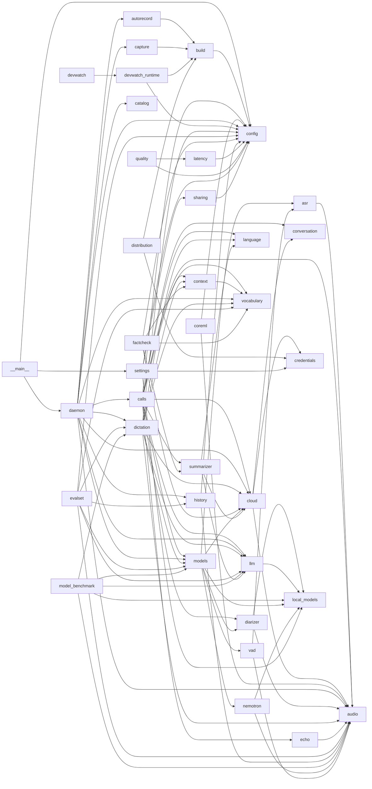

# Архитектура

Карта реализации Python и Swift: зависимости, API и runtime-контракты. Обновляется при изменении модулей, публичных функций/типов и на структурном ревью; граф строится по коду командой Graph из AGENTS.md, не по плану. Продуктовые критерии и ограничения — в [SPEC](SPEC.md), команды и developer flow — в [README](README.md).

Последняя проверка структуры: GUI-only, private serve/setup bootstrap и сохраняемый выключатель созвонов. Фактический `uv run --offline --no-sync pydeps wav2sum --show-deps --no-output --only wav2sum`: 37 модулей без корневого пакета, 94 внутренние связи; граф ацикличен. Пользовательские cli/tui, Textual и runtime Python client удалены; socket test support остаётся в tests. Хранение app preferences находится в config, JSON setup bridge — в settings; обратной зависимости config→settings нет.

## Модули

| Модуль | Отвечает за | Зависит от |
|---|---|---|
| `__main__` | private serve/setup dispatch для native app; пользовательских команд нет | config, daemon, settings |
| `devwatch` | debounce, immutable snapshot handoff, повторы/восстановление и безопасное завершение dev-сессии | devwatch_runtime |
| `devwatch_runtime` | lock, verified exact-child pipes, перепроверка bundle/путей и lifetime только собственного scratch; использует общий builder | build, config |
| `daemon` | mode/busy/calls-enabled/configure guards, read-only history RPC, manual/opt-in call jobs, ordered dictation/cancel и retention | audio, autorecord, calls, capture, catalog, cloud, config, dictation, history, llm, models, vocabulary |
| `catalog` | CallEntry из raw WAV/processed meta, дедупликация по resolved audio и прежняя mtime-сортировка; ошибки чтения не скрываются | — |
| `calls` | local echo/VAD/pyannote/Qwen или Nemotron без summary, backend-specific cache; cloud grounded summary и summary-only | audio, cloud, config, context, conversation, diarizer, echo, language, llm, models, summarizer, vocabulary |
| `capture` | запись звонка Swift-хелпером в WAV | build |
| `autorecord` | какое приложение держит микрофон, когда начать и остановить запись | build |
| `build` | единый immutable snapshot → app/icon/digest/sign, проверка dev signature/layout, атомарная публикация install/bootstrap/watch; bundled capture_helper берётся из проверенного executable env path | config |
| `echo` | вычитание эха системного канала из микрофона | audio |
| `conversation` | склейка реплик, текстовый echo-filter, формат транскрипта; `Piece` для окон звонка | — |
| `summarizer` | проверенные видимые ссылки на реплики, source-preserving фрагментация/сведение в пределах контекста; отдельные главы | cloud, language, llm |
| `dictation` | фиксированный контекст, прямая LLM-чистка без семантических эвристик; cloud upload без preview или incremental local с ограниченным хвостом | audio, cloud, config, context, language, llm, models, vocabulary |
| `context` | фиксированные ограниченные подсказки и точная транслитерация смешанных алфавитов в заданный термин; без I/O | vocabulary |
| `models` | lazy режим и call_model, memory warning override, scoped call_session освобождает Qwen/Nemotron | asr, cloud, diarizer, local_models, nemotron, vad |
| `asr` | pinned offline Qwen для диктовки/лёгких звонков | audio |
| `cloud` | Deepgram batch HTTP для звонков/файлов и один chunked upload диктовки; OpenAI HTTPS с ленивым per-client keepalive; proxy/TLS, безопасные ошибки и запрет редиректов/replay | audio, conversation, credentials |
| `credentials` | explicit env/Keychain/opt-in beta resource lookup, native secret storage; no passive Keychain read or denial bypass | — |
| `nemotron` | speech.cpp protocol 3, явные overrides/new model root/legacy paths, on-demand worker и reap | audio, local_models |
| `vad` | batch Silero для звонка и изолированное incremental-состояние диктовки на чанках 512 сэмплов | asr, audio |
| `diarizer` | prepared pinned local pyannote или explicit legacy HF auth; telemetry off | audio, local_models |
| `language` | RU/EN по финальному тексту для чистки/summary; старый SpeechBrain удалён | — |
| `llm` | mlx-lm worker, pinned prepared default Gemma, unload/prefix cache/prompt lookup | local_models |
| `vocabulary` | словарь замен, который учится на правках | — |
| `history` | история, сохранённые storage helpers удаления; atomic seven-day prune под общим lock, сохранение unknown-age и отказ от malformed/unsafe files | audio, config |
| `config` | TOML, app preference schema/consent/calls-enabled, atomic private JSON save/load, runtime cloud, shared file lock | — |
| `audio` | загрузка звука, PCM, хеш файла | — |
| `coreml` | CPU-загрузка закреплённого GigaAM и конвертация в Core ML (CHU-98), только macOS | audio, config |
| `evalset` | WER диктовки на наборе фраз | audio, config, dictation, history, llm, models, vocabulary |
| `factcheck` | cloud summary с таймкодами; игнорирование ссылок при проверке чисел/имён; требует `--cloud` | cloud, config, context, summarizer, vocabulary |
| `latency` | read-only p50/p90 частей и local/cloud streaming p50/p95/отношение отправленного к полученному | config |
| `quality` | качество диктовки по истории | config, latency |
| `settings` | JSON stdin/stdout app bridge, passive status, explicit Keychain/download/configure/export actions, sanitized errors | config, credentials, local_models, sharing |
| `sharing` | read-only locked snapshots, content ids, confirmed selected text-only consent export, atomic no-clobber | config |
| `local_models` | privacy-safe hardware, provisional RAM profiles, memory guard, pinned explicit model/runtime preparation | — |
| `model_benchmark` | synthetic/explicit local ASR+cleanup repeats, quality refs, process-tree RSS/system swap, no text by default | audio, dictation, llm, local_models, models |
| `distribution` | fresh app/DMG, runtime/FFmpeg/codec relocation; ordinary build without keys, explicit private-beta hidden prompts and signed credentials resource | build, credentials |

## Границы компонентов

- `config` читает TOML, хранит согласие и параметры в приватных app preferences. Переопределение режима происходит при явном запуске runtime. `settings` обслуживает JSON-запросы нативного приложения; чтение статуса обходится без загрузок моделей и обращения к Keychain.
- `daemon` владеет сокетом, записью и жизненным циклом моделей. `calls` отвечает за результаты и кэш распознавания, `catalog` читает метаданные для истории, `history` ведёт журнал диктовки и удаляет только записи с подтверждённым возрастом старше семи суток.
- `dictation` фиксирует словарь, язык, стиль и примеры в начале сессии. `models` выбирает ASR внутри установленного режима. `cloud` держит один запрос диктовки и выдаёт полный финал после EOF. Локальная ветка использует потоковый VAD и MLX для чистки.
- `sharing` заново сверяет выбранные источники перед подтверждённым экспортом текста и атомарно создаёт новый файл. `build`, `devwatch` и `distribution` отвечают за dev-сборку, её замену и standalone-пакет соответственно.

## Native UI и протокол

`MainWindow.swift` и вложенный `HistoryView.swift` — UI-проекции общего с меню состояния `AppDelegate`. Окно показывается после Apply, при обычном completed launch и через Open wav2sum; dev-watch handoff не активирует его. Pending start/stop различаются до ACK; recording.seconds приходит из snapshot и обновляется level-events. Disconnect показывает неизвестное состояние, не остановку. Stop ACK подтверждает saved path; inactive-event — только завершение. После idle Apply перечитывается status для auto-process.

Главное окно использует AppKit sidebar записи/диктовки и горизонтальный list/detail истории. `MainWindow.State.recordingActive` явно выбирает Start/Stop symbol, без разбора текста кнопки. `HistoryCell` переиспользуется таблицей; полные детали и ошибки доступны для выделения, длинный feedback прокручивается, основные действия остаются видимыми. Semantic colors и системные шрифты поддерживают light/dark.

Единственный выключатель созвонов находится в Settings и сохраняется через Apply/configure/restart. При выключении call recording/timer/processing и Calls history скрыты, Dictations остаётся; главное окно и меню читают status.calls_enabled, но не предлагают второй точки изменения. Settings скрывает call-only controls и передаёт calls_enabled в явную подготовку моделей. Сохранение настроек не подтверждает новые cloud uploads и не удаляет данные.

`SetupWindow` — сгруппированная scroll-форма с закреплённым Apply; private `SettingsForm.isFlipped` удерживает начало формы сверху. Главное окно и Settings автоматически пересчитывают native key-view loop при появлении деталей/смене секций; `⌘R` обновляет историю, `⌘,` открывает Settings из главного окна. Согласия, busy/ACK veto и действия с ключами/моделями/permissions остаются прежними.

Refresh формы сериализован с Apply; начальные completion не теряются при повторном открытии Settings. Native отслеживает собственный незавершённый запуск daemon до соединения или подтверждённого выхода процесса и не выдаёт его за Off. После mode mismatch явное configure остаётся доступным под backend busy guards; no-restart recovery выполняет настоящий subscribe. Connection error блокирует cached history actions. Неоднозначный configure ACK не запускает автоматическую повторную запись preferences.

Swift общается с Python через `~/Library/Application Support/wav2sum/daemon.sock`, JSON-строками. Пользовательские CLI/TUI и Python runtime-клиент удалены; socket client для Python-проверок находится только в tests. Управление: `status`, `subscribe`, `history`, `configure`, `record_start`, `record_stop`, `process`, `summarize_last_meeting`, `shutdown`; диктовка: `dictate_audio`, `dictate_cancel`, `dictate`, `correction`.

- `dictate_audio`: PCM-чанк; `first` начинает сессию. Swift передаёт строковый `session` в чанках, финале и отмене. `dictate_cancel` действует на текущую сессию исходного соединения при совпадении ID.
- Финальный `dictate`: `command`/`translate` выбирают режим, при `streamed` поле `audio` содержит только неотправленный хвост; `before`/`after` — до 20 символов вокруг курсора для `fit_to_cursor`. Клиенты без `session` не запрашивают preview.
- `dictation_preview` содержит `session`/`text` и идёт только исходному соединению. Неизменившийся текст и поздние события завершённой/заменённой/отменённой сессии отбрасываются. Это дедупликация события, не гарантия отсутствия повторной работы ASR.
- `history` требует совпадающий `cloud`, но не credentials/модели/API. Ответ: `calls`, `dictations`, `recordings_dir`, `output_dir`. Call содержит `id/path/title`, resolved `audio`, nullable `out_dir/open_path`, `state/stage/error`, `duration_sec`, `speakers`; latest job и active recorder накладываются на read-only catalog. Dictation содержит content-derived ID с ordinal одинаковых записей, `time/text/raw/mode`; прежние последние 500 записей, без записи ID в JSONL.
- Native подписывается до чтения истории; один in-flight request и revision/token отбрасывают snapshot после события/disconnect/смены соединения. Selection сохраняется по ID, raw→processed — только по единственному audio match; удаление/неоднозначность снимают её. Read failures явные; disconnect/mode mismatch запрещают stale actions. Level events не перезагружают таблицы.
- `history_pruned` содержит только `deleted` count: native запрашивает snapshot. `DictationController.Phase` и error/result callbacks обновляют главное окно; оно и Settings используют общий `permissionSummary`. Paste request не считается подтверждённой вставкой.

## Runtime и lifecycle

### Режим, модели и ключи

Cloud выбирается явно в GUI, не выводится из наличия ключей. Private bootstrap `python -m wav2sum serve [--cloud]` / `setup` сохраняет существующую bundle-команду без изменения Info.plist. JSON setup bridge читает/сохраняет app preferences. `configure` валидирует согласия под recording lock и отклоняется при recorder/streams/loading/queued/running jobs. Смена mode/model/calls_enabled сохраняет preferences и завершает idle daemon; native ждёт старый socket перед новым стартом. Auto-process-only применяется live. Setup сохраняет preferences напрямую только при недоступном socket, не после отказа или неоднозначного ответа.

`calls_enabled` по умолчанию true, включая прежние app preferences. При false daemon не запускает watcher, не создаёт call summary client, запрещает запись/process/summary до capture/provider effects и не сканирует call catalog. Диктовка, её warmup и история работают независимо. Подготовка моделей в этом режиме скачивает только Qwen/Gemma, не требует Nemotron memory override и gated pyannote; уже скачанные веса и сохранённые данные остаются на месте.

Local preload — Qwen/VAD/Gemma диктовки. Отдельный `call_session` выбирает Qwen/Nemotron, освобождает call ASR в finally и reap-ит worker; cache hit не загружает его. У моделей и ленивой загрузки раздельные locks по имени. Pinned snapshots готовятся явно; подготовленный pyannote работает без токена, telemetry выключена. Gated access принимает пользователь, токен подготовки не сохраняется. Cloud warmup проверяет keys без paid-запросов; исправление настроек перезапускает только idle failed daemon.

Cloud credentials: env → собственный Keychain → opt-in beta resource → ошибка. Keychain denial не обходится; ресурс не импортируется автоматически. Native secure fields передают секреты по stdin pipe, не argv/логам. Add/update сохраняет прежние service/accounts и ACL. Passive status проверяет presence, не читает Keychain; Local ключи не читает. Private-beta builder получает оба friend-ключа явно в интерактивном terminal, не обнаруживает их в env/Keychain; обычная сборка не включает ресурс.

### Диктовка

Swift отправляет новые PCM каждые 1 с local / 250 мс cloud и остаток при release. Local использует независимое состояние Silero по 512 samples, completed spans и изменяемый recognition tail; preview не используется как финал. Qwen checkpoint закреплён на `bcd2b5b7f32b480ab5790554cfa8347f246a14f3`. Local HUD 320×80 перетаскивается без активации и сохраняет позицию в процессе; клик по нему не инвалидирует target. Cloud HUD 190×40 пропускает клики и не показывает текстовый preview.

Native `Microphone` использует Audio Queue input с client float32/mono/16 кГц; hardware sample rate не передаётся в AVAudioEngine tap. Core Audio выбирает устройство по UID до старта и преобразует hardware PCM. При Bluetooth default сохраняется предпочтение встроенного input. Default input и изменения выбранного устройства перестраивают захват, но сохраняют накопленные samples и streaming cursor; физическое переключение может дать короткий разрыв звука. Session/input generations запрещают старые buffers, callbacks и рестарты после stop/cancel/замены.

`Microphone.start(onError:)` и `DictationController.Effects.audio.start` передают ошибку текущего захвата на main queue. Controller проверяет identity диктовочной сессии, отменяет только её и показывает ошибку через существующий onError; следующая попытка не блокируется старым callback. Обычный stop дожидается захваченного хвоста и возвращает накопленную ошибку до ASR, даже если main callback ещё не выполнен; cancel отдельно отбрасывает позднее PCM и ошибки. Сокет, формат PCM на Python-границе и хранение не меняются.

Cloud начинает один HTTP/1.1 chunked upload raw linear16/16 кГц/mono с первым непустым PCM; EOF идёт после последнего чанка, полный HTTP response — единственный финал. Повторного ASR/replay нет. Backlog ограничен: overflow завершает сессию ошибкой, не теряет молча чанки; один готовый большой вход допустим. Finish single-flight, успешный ответ кэшируется, deadline — 20 с после закрытия входа; HTTP timeout звонков — 300 с. Upload перекрывает setup со временем речи, не доказывает начало provider inference или гарантии chunked buffering.

`DictationContext` фиксирует стиль, язык, snippets, термины и исправления при первом чанке. До 50 уникальных терминов/500 UTF-8 bytes без управляющих символов: Qwen contextual prompt, Deepgram repeated keyterm, Nemotron worker prompt; cache звонков различает контекст. Mixed Cyrillic/Latin нормализуется только при точной транслитерации заданного термина, без fuzzy/обучения. Nova-3 auto использует `multi` с RU/EN language hints, explicit ru/en — fixed language без hints. Nemotron 0.9.4 валидирует language, но не ограничивает им ASR; явный язык выбирает язык результата.

LLM получает исходный ASR со snippet-маркерами, без regex-подготовки самокоррекций/семантических postchecks; непустой успешный ответ принимается. Обычная ошибка/пустой ответ сохраняет raw, ошибка перевода ничего не вставляет. Словарь, snippets, стиль и подгонка к курсору остаются. Cloud cleanup — `gpt-6-luna`, Fast; summary — `gpt-6.1-terra` без явного Fast. Оба через Chat Completions с `reasoning_effort=none`.

Финальный запрос захватывает исходную сессию в порядке чтения сокета до фоновой обработки, также без `session`; последующие запросы не блокируются LLM. Cancel/замена/disconnect/shutdown закрывают транспорт и отбрасывают поздний результат до вставки/history. Cloud close будит finish, очищает backlog и best-effort закрывает active socket без ожидания сети; уже начатые DNS/connect или local inference могут завершиться позже. Отправленный неоднозначно POST не повторяется. При завершении daemon ждёт in-flight model work; factcheck закрывает свой LLM в finally, cancellation сохраняет CancelledError даже при ошибке фоновой работы.

### LLM worker и transport

MLX работает в одном потоке `llm`. Запрос с timeout может выполняться между prefill/token steps обычной генерации; просроченная диктовка отменяется с raw fallback. Одинаковые модели делят веса. Idle unload освобождает и веса, и prefix cache; `llm_memory_mb` учитывает их отдельно от model memory. Prefix cache хранит до четырёх token-prefix entries на модель и генерирует на копии; summary без prefix cache. Prompt lookup для clean ищет последние 3/2/1 токена в prompt, предлагает до четырёх draft tokens; перевод/команда идут обычной генерацией. `user_examples` берёт по три последних допустимых edits на стиль/язык, иначе статичные; snapshot до restart сохраняет cache hits, `learn=false` запрещает запись.

`_draft` сохраняет longest suffix (3→2→1), затем latest match, включая overlap/короткий результат. Candidate tokens сравниваются по индексам без временных списков; копируется только возвращаемый draft. При size=0 поиск не выполняется. Это оптимизация Python lookup, не смена sampling/model/cache и не доказанное ускорение полного inference.

На OpenAILLM — одно direct HTTP/1.1 соединение с lock и verified TLS. Proxy остаётся на urllib без pooling/direct preconnect. Непустое cloud audio при cleanup запускает один best-effort TCP/TLS warming worker без HTTP/keys/text; продолжение аудио обновляет обнаруженный закрытый peer, idle reconnect timer отсутствует. Connect вне transport lock: foreground не ждёт warming и при miss идёт штатно. Peer отбрасывается перед POST, если закрытие обнаружено. `unload` закрывает transport и инвалидирует pending connect по generation: поздний socket не заменяет активный и не восстанавливает закрытый клиент. DNS/connect cancellation best-effort, неоднозначная ошибка POST не вызывает replay.

### Звонки и результаты

Stop/startup по умолчанию не enqueue-ят обработку. При включённых созвонах opt-in ставит успешно завершённую запись в обычную очередь: local transcript-only, cloud — с отдельным auto-upload consent. Capture error не запускает job. Guards active/duplicate/ambiguous/partial защищают daemon requests. Local pipeline: echo → VAD/pyannote → Qwen windows до 20 с или Nemotron до 50 с без пересечения говорящих/выдуманных word timestamps; язык определяется по каналу, язык результата — мой канал либо собеседник, если я молчал. Системный канал допускает 1–6 собеседников, один остаётся без номера; явное speaker-name имеет приоритет. Cloud использует Deepgram utterances/diarize и grounded summary.

`summarize_last_meeting` cloud-only выбирает собственный completed call по started_at с fallback audio chronology, не mtime output. Готовый summary возвращает `{out_dir, already_done:true}`; иначе `{job}`, queued summary-only уже содержит out_dir существующего transcript. Raw идёт полным pipeline, готовый transcript — без audio/ASR. Running job переиспользуется; unfinished sidecar, ambiguous и partial output отклоняются. Только отсутствующий summary.md публикуется атомарно, исходники не переписываются; новое завершение уведомляет без принудительного открытия. Native in-flight guard исключает повторный UI request.

Grounded summary проверяет существование и видимость `[U… время]` в текущей части/заметках, не semantic entailment. Длинная реплика делится с тем же настоящим ID/диапазоном, map/reduce укладывается в token context; factcheck не считает citations новыми числами/именами. Optional chapters — отдельный вызов, привязка времени к реплике в пределах 5 с и сведение сверх восьми строк; их ошибка не отменяет успешный transcript/summary.

### Dev-watch и экспорт

Watcher управляет только собственным подписанным dev child. Общий builder делает immutable snapshot/app/icon/framed digest и сохраняет совместимую Info.plist. Main-thread handoff блокирует новую диктовку и ждёт capture/finalize/selection/insertion probe/correction и control ACK; daemon/recording/jobs не останавливает. Editor saves после ready переходят в следующую сборку. Failed build сохраняет latest attempt с backoff; отказ запуска допускает verified rollback, неопределённость останавливает exchange без сигналов/повтора. Только после ACK нового child удаляются собственные scratch/previous bundle, не старые каталоги. Защиты от враждебного writer между проверкой и syscall нет. Bootstrap, Ctrl-C/recovery и ограничения параллельного запуска — в README.

`sharing` читает history/edits под прежними locks и выдаёт content-stable IDs. UI фильтрует и выбирает только показанное; правка target снимает confirmation. Export повторно разрешает IDs по текущим источникам, требует consent/confirmed target и атомарно создаёт private JSONL без overwrite. Только allowlisted text, без timestamps/app/title/paths/audio/calls/network; источники не меняются, экспорт не входит в seven-day retention.

### Метрики и исследовательские инструменты

`timings.preview` — от первого полученного audio до первого preview (local и исторический cloud WS); `finalize` — от захвата streamed final request до готовности Dictation, включая readiness/in-flight step/worker waits, до append/broadcast/reply. `asr` оборачивает finish/recognize, `llm` — clean/command/translate с обработкой текста: очереди, transport и provider inference ими не разделены. `asr_live` — local работа во время речи, не post-release/cloud latency. Cloud `audio_sent/audio_received` — секунды; успешный sent отражает полный submitted audio, не acknowledgement чанков/биллинг. `latency` разделяет local/cloud, но исторические WS/batch-записи не являются baseline текущего upload. HTTP headers/TTFB wait тоже не отделяет сеть от работы провайдера.

Swift логирует event-tap release→ready/send и отдельный insertion probe в app.log. Ready timestamp берётся после ответа и target safety checks, send — перед отправкой ⌘V; hands-free завершение нажатием не является key-up release. Probe измеряет интервал до точного AX-значения исходного поля после замены UTF-16 selection. Проверки раз в 25 мс не дольше 2 с после send; интервал — наблюдаемая неопределённость, не гарантированная ошибка ≤25 мс. Missing AX/неизменившееся поле/mismatch/timeout — unavailable/unconfirmed; clipboard-only не измеряется. Текст поля не логируется; это не screen paint/физический контакт клавиши. Отдельный synthetic helper не наследует TCC grants рабочего app и не доказывает production release→paste.

`evalset` — append-only нумерация 46 эталонных фраз, отдельные ASR/clean WER и термины; фиксированный seed чистки, не semantic-quality score. `factcheck --cloud` — новый paid summary выбранных transcript, числовые/именные расхождения не проверяют связь двух верных фактов и числа словами. Core ML-конвертер GigaAM не включён в runtime приложения; его прошлые ANE-результаты не переносятся на текущие Qwen/Nemotron.

## Известные проблемы

- `daemon.py`: битая JSON-строка закрывает соединение без отдельного ответа/лога (CHU-153); `json.loads` уже находится внутри `try`, прежнее описание «вне try» устарело.
- `summarizer.chunk_transcript` намеренно не дробит одну длинную реплику для optional chapters. Монолог может превысить контекст провайдера; основной grounded summary использует другой bounded splitter. Ошибка optional chapters теперь не отменяет публикацию успешного transcript/summary; смену контракта chunker не делали.
- Development capture/autorecord по-прежнему могут собирать helper через build.capture_helper; standalone app передаёт уже собранный helper, поэтому Xcode на машине получателя не нужен.
